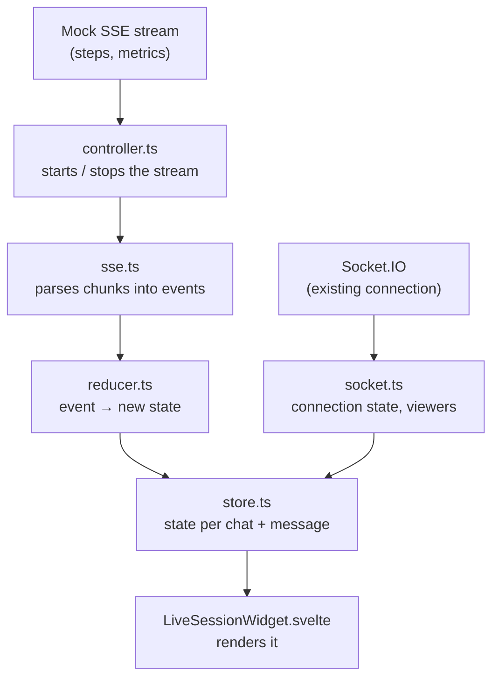

# Live Session Widget

A small widget under each assistant answer in Open WebUI. While the answer streams it shows the status, a live list of steps, metrics (tokens, sources, confidence, tokens/s), the WebSocket state and how many tabs are viewing the chat. When the answer is done it folds into one line and is saved with the message.

Branch: `feat/live-session-widget`. Everything is behind one flag, `ENABLE_LIVE_SESSION_MOCK` (off by default: Open WebUI then behaves exactly as before).

## Try the demo

A private demo runs on a DigitalOcean server. **The access link and a reviewer login are in my submission email** (the repo is public, so they are not written here). Open the link once; the browser then keeps access for 7 days.

1. Log in, pick `fake-model`, send any message.
2. Watch the widget: Starting → Streaming (steps, tokens) → Complete, then it folds into one line.
3. Send again and press **Stop**: the widget shows a gray `Stopped`.
4. Open the same chat in a second tab: `2 viewing`.
5. Reload the page: finished widgets come back.

`fake-model` is a free local test model; answers are always the same text. You can also pick `gpt-5-nano` (a real OpenAI model) from the model list: it gives real answers, but the widget's steps and metrics still come from the mock stream.

### How the demo is hosted

- **Server:** one DigitalOcean Droplet (Ubuntu 24.04, 2 GB RAM), running Docker Compose with three containers: Open WebUI (with the flag on), the fake model and Caddy.
- **Deploy:** a separate branch, `demo/deploy`, is this branch plus only the deploy files (`deploy/`, `.github/workflows/demo-deploy.yml`). On every push, GitHub Actions builds the slim Docker image (the frontend build needs more memory than the server has), stores it in GitHub's registry, then connects over SSH and restarts the containers. Accounts and chats live in a Docker volume, so they survive deploys.
- **HTTPS:** Caddy gets a free Let's Encrypt certificate automatically. The address uses sslip.io, which turns the server IP into a host name, so no domain had to be bought.
- **Access:** Caddy only lets in browsers that opened the secret link once (it sets a 7-day cookie); everyone else gets "Not found". Behind that is the normal Open WebUI login, with sign-ups turned off. The gate fails closed: if the secret is missing, nobody gets in, and the deploy refuses to run.
- **Security basics:** SSH with keys only, firewall open only for SSH, HTTP and HTTPS. Secrets live only on the server and in GitHub Actions secrets, never in the repo. Workflow actions are pinned to exact commits.
- **Models:** `fake-model` and one small OpenAI model (`gpt-5-nano`, with a spending limit). Switching models only changes the answer text: the widget's steps and metrics come from the mock SSE stream either way.
- The server, keys and repo are removed after the review.

## Run it locally

```bash
# 1. Settings: create .env in the repo root
cat > .env <<EOF
ENABLE_LIVE_SESSION_MOCK=true
USE_SLIM_DOCKER=true
WEBUI_SECRET_KEY=$(openssl rand -hex 32)
EOF

# 2. Backend (Python 3.11 or 3.12), first terminal
cd backend
python3.12 -m venv .venv && source .venv/bin/activate
pip install -r requirements-slim.txt
./dev.sh                                             # http://localhost:8080

# 3. Frontend (Node 18–22), second terminal, repo root
npm ci && npm run dev                                # http://localhost:5173

# 4. Test model, no key needed, third terminal, repo root
python3 scripts/live-session/fake_openai_server.py   # http://localhost:8099
```

Open http://localhost:5173 and sign up: the first account becomes admin. Then **Admin Panel → Settings → Connections → OpenAI API → +**: URL `http://localhost:8099/v1`, any key.

`USE_SLIM_DOCKER=true` is needed with `requirements-slim.txt`, and `WEBUI_SECRET_KEY` is required by `./dev.sh`.

## Tests

```bash
npx vitest run src/lib/liveSession        # 74 unit tests
LIVE_SESSION_INTEGRATION=1 npx vitest run src/lib/liveSession/socket.integration.test.ts   # real Socket.IO reconnect
```

The integration test uses `backend/.venv/bin/python`; set `LIVE_SESSION_PYTHON=/path/to/python` if your environment is elsewhere.

They cover split chunks (every byte position), duplicate events, broken JSON, done/error, Stop, leaving the chat, reconnect and resubscribe, and saving/restoring the widget.

## How it works

Two data sources feed one store; the widget only reads the store.



1. **Per answer (SSE):** the controller opens the stream, the parser turns raw chunks into events, the reducer turns each event into the next state.
2. **Per chat (Socket.IO):** connection state and the number of viewers.
3. **Store** keeps both, keyed by `chatId:messageId`; the widget just shows it.

- **Logic outside Svelte.** Parser, reducer, store and controller are plain TypeScript with unit tests; the component only renders.
- **One widget per answer**, keyed by `chatId:messageId`. Regenerate makes a new message id, so old events can never reach a new widget.
- **No stale updates.** The controller drops chunks from a stream that was stopped or replaced; the reducer ignores events after done/error.
- **Reuses Open WebUI's socket.** The chat room join/leave/rejoin already exists; two small events (`live:presence`, `live:session_status`) ride on it. Viewers = open tabs in the chat room.
- **Saved with the message.** A finished widget is stored on its message (`liveSession`) and shown again after a reload.
- **Quiet UI.** Color only for what needs attention (blue running, amber/red connection, red failure); Stop is gray, not an error.

Backend changes are small: a dev-only SSE endpoint, a snapshot endpoint and two socket events (`backend/open_webui/routers/live_session.py`, `socket/main.py`).

## Requirements

| Brief                                                          | Status   |
| -------------------------------------------------------------- | -------- |
| Widget per generation, scoped by chat and message              | Done     |
| Status: starting, streaming, complete, error                   | Done     |
| Streamed steps, live metrics                                   | Done     |
| WebSocket state, active viewers                                | Done     |
| Navigation, Stop, retry/regenerate, unmount without stale data | Done     |
| Parser/reducer tests, reconnect test                           | Done     |
| Stretch: collapsed mode, ARIA/keyboard/reduced motion          | Done     |
| Stretch: save the final widget with the message                | Done     |
| Stretch: end-to-end smoke test                                 | Not done |

## Before production

- Real steps and metrics from the model pipeline instead of the mock script.
- Access checks and rate limits on the stream endpoint.
- Presence across several servers (now counted per process).
- Translations for the new strings.

## Use of AI tools

I used Claude Code as a pair programmer: to explain the Open WebUI codebase (I come from React), propose the design, write code and tests, and check the result in a browser. I reviewed every change and asked for proof, for example breaking the code on purpose to see the tests fail. My decisions: the order of work, testing with a free fake model, small separate commits, the final widget layout (under the answer, full width, collapsed line), and hosting a private demo.
